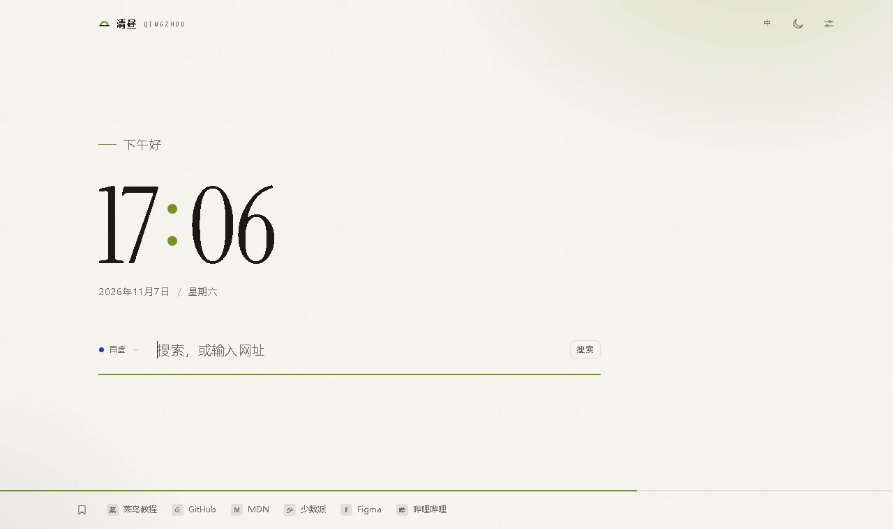
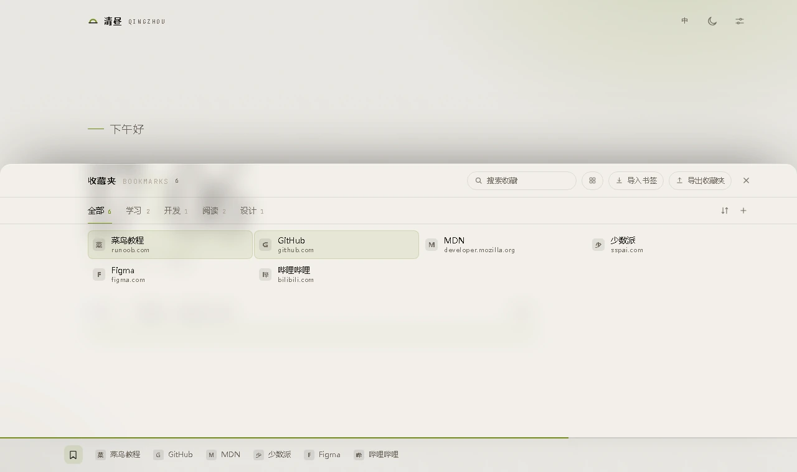
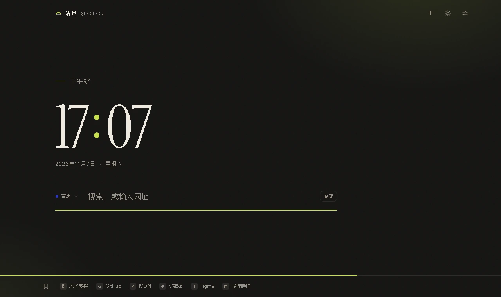

# 清昼 · 简约起始页

一个把「少」做到位的新标签页：大时钟、一句问候、一条搜索、一条正在走的进度线。

纯本地运行——**不联网、不注册、没有后台进程**。所有字体、图标、样式都在包里，断网、隐私模式下同样可用。



<details>
<summary>更多截图</summary>





</details>

## 特性

| 能力 | 说明 |
| --- | --- |
| **大时钟** | 分钟级刷新，对齐到下一整分；预热的单个 `setTimeout`，没有 `requestAnimationFrame` 循环 |
| **日光进度** | 底部全幅细线 + 百分比，单位可切「日 / 周 / 月 / 年」（周一为一周起点） |
| **搜索** | 百度、必应、Google、搜狗、360、DuckDuckGo，可自建带 `%s` 的引擎；输入 `github.com` 直接打开 |
| **搜索历史** | 点搜索框浮出最近 8 条，继续输入按关键词过滤，单条可删 |
| **收藏夹 dock** | 鼠标移到底栏浮出常用收藏，放不下的收成 `…`；支持拖动排序、只看置顶 |
| **收藏管理** | 导入 / 导出浏览器书签 HTML、分类增删改、标题网址编辑、置顶、按名称或网站排序、长条与图标两种视图 |
| **主题** | 7 套预设配色 + 自定义取色，深浅色跟随系统；每套配色只声明两个色值，其余由 `color-mix()` 派生 |
| **背景** | 可选本地图片，自动压到 1600px 内，模糊 0–40px 可调 |
| **三语** | 中文 / English / 日本語，界面文案、日期格式、问候语一并切换 |

## 安装

**方式一：下载安装包**（推荐给只想用的人）

1. 到 [Releases](../../releases) 下载 `qingzhou-x.y.z.zip`，解压得到 `qingzhou/` 文件夹
2. 浏览器打开 `chrome://extensions`（Edge 为 `edge://extensions`）
3. 右上角（Edge 在左下角）打开「开发者模式」
4. 点「加载已解压的扩展程序」，选中整个 `qingzhou/` 文件夹
5. 新开一个标签页

**方式二：从源码加载**

```bash
git clone <本仓库地址>
```

然后在扩展页里选中 `qingzhou/` 目录。

> 文件夹请放在固定位置，浏览器会一直引用这个路径。更新版本时覆盖文件后，**必须在扩展页点一下刷新**，
> 否则浏览器仍跑旧缓存（右下角版本号不会变）。

要求 Chrome / Edge **111 及以上**（用到了 `color-mix()` 与 `backdrop-filter`）。

## 目录结构

```
.
├── qingzhou/              # 扩展本体，加载这个目录
│   ├── manifest.json      # MV3：newtab 覆盖 + 工具栏弹窗 + activeTab
│   ├── newtab.html        # 结构；首帧前内联脚本定主题，避免闪白
│   ├── popup.html         # 工具栏弹窗：收藏当前页
│   ├── scripts/           # i18n / 收藏夹数据层 / 页面逻辑 / 弹窗逻辑
│   ├── styles/            # 令牌、基础层、组件、弹窗
│   ├── fonts/             # 字体子集（10KB，无网络字体）
│   ├── icons/             # 16 / 32 / 48 / 128
│   ├── tools/             # 图标生成脚本（纯标准库）
│   └── README.md          # 设计与实现说明（配色机制、毛玻璃、冒号对齐等）
├── dist/                  # 打包产物：安装包 + 源码包
├── docs/                  # 截图
└── LICENSE
```

## 开销

| 项 | 数据 |
| --- | --- |
| 网络请求 | **0**（字体、图标、样式全在包内；导入的书签图标是 base64 内嵌） |
| 安装包 / 解压后 | 68KB / 201KB |
| 后台脚本 | 无 |
| 权限 | 仅 `activeTab`——只在点开工具栏图标那一刻临时读当前页标题与网址 |
| 定时器 | 全局 1 个 `setTimeout`，对齐下一整分；标签页隐藏时不做任何工作 |
| 存储 | `localStorage`，17 个 key，收藏夹上限 3000 条 |

对照常见的起始页扩展（`iframe` 外链线上站点 + MB 级视频壁纸），这个实现是零网络、纯本地。

## 开发

没有构建步骤，改完文件在扩展页点刷新即可。打包两个 zip：

```bash
python pack.py
```

版本号直接读 `qingzhou/manifest.json`，改完 manifest 跑一次就行。
`使用说明.txt` 会被放进安装包，`README.md` 与 `LICENSE` 只进源码包。

## 更新日志

- **2.3.2** 修：拖动 dock 上的收藏时，整条 dock 会塌回进度条（浏览器在拖拽开始时补发 `pointerleave`）；
  现在拖动期间一律按展开处理，松手再按落点决定
- **2.3.0** 新增收藏卡片与 dock 的拖动排序；设置里可让 dock 只显示置顶项
- **2.2.0** 新增书签导出、面板毛玻璃透明度、图标视图、自定义搜索引擎、置顶与排序
- **2.0** 定稿：三语切换、进度单位、自定义称呼、自定义背景图

## 许可

[MIT](LICENSE)
